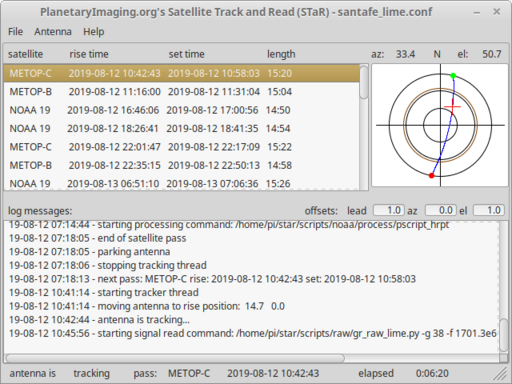
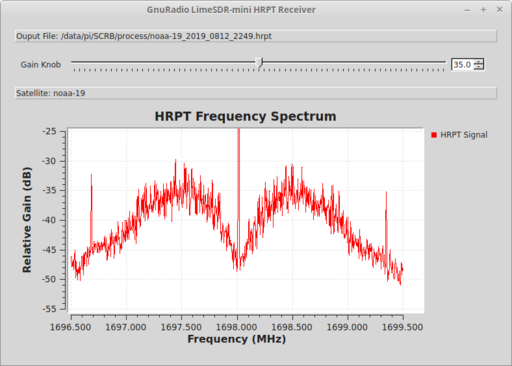
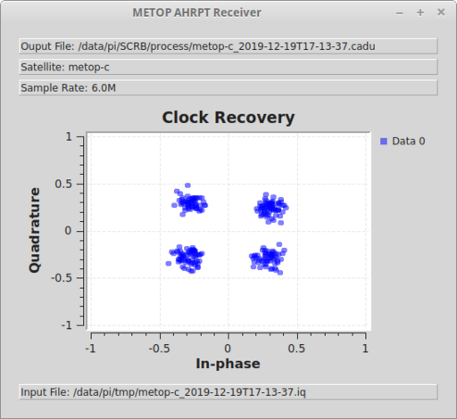
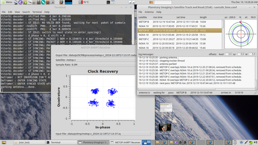
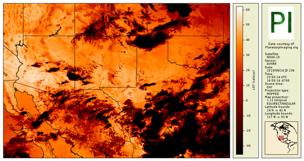
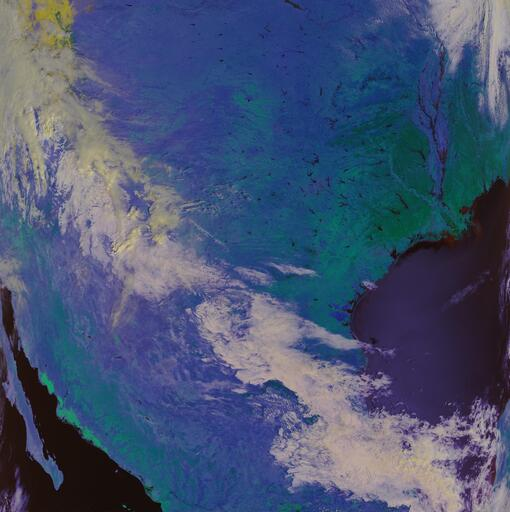
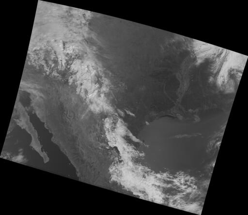

## Description
Satellite Track and Read (STaR) is a general satellite scheduling and tracking program with modular motion control and signal processing for polar orbiting direct broadcast satellites. Agrineer's STaR runs on GNU/Linux platforms. Originally designed for older generation NOAA/METOP satellites the package is now transitioning to current platforms.

The star project is being developed as an educational package for student agricultural data scientists and engineers, giving a hands-on experience on how remote-sensing data is acquired, processed, and implemented for agricultural purposes. STaR signal processing programs yield Level 0 packets using GnuRadio modules and addition processing is 
provided as product processing examples, such as Albedo values, Normalized Difference Vegetation Index (NDVI), Land Surface Temperature (LST), etc. 

NOTE: This project is migrating from planetaryimaging.org and is currently under construction with rapid changes, with some changes not thoroughly exercised so check in periodically.

## GUI 
The Graphical User Interface for STaR is the Python program stargui.py, shown below:

Satellite pass scheduling, signal acquisition, tracking motion control is coordinated by stargui.py
and is built in a modular form so different satellite antenna rigs can be used. A dummy rig is given as an example interface.

## Signal Processing
GnuRadio NOAA-19 HRPT acquisition signal, using a $20 receiver, shown below:

GnuRadio METOP-C AHRPT Constellation acquisition signal with, shown below:

## User Screen
A typical user screen shown below:

## Some Older Products
NOAA-19 HRPT projected Land Surface Temperature (LST), useful in energy balance equation, shown below:

METOP-C Level 1 Pseudo-colored Normalized Difference Vegetation Index (NDVI)

METOP-C projected band 1 visible, shown below:

## License
STaR is released under the GNU General Public License GPLV3 as published by the Free Software Foundation. Third party components carry their own licenses. See https://www.gnu.org/licenses/gpl-3.0-standalone.html

